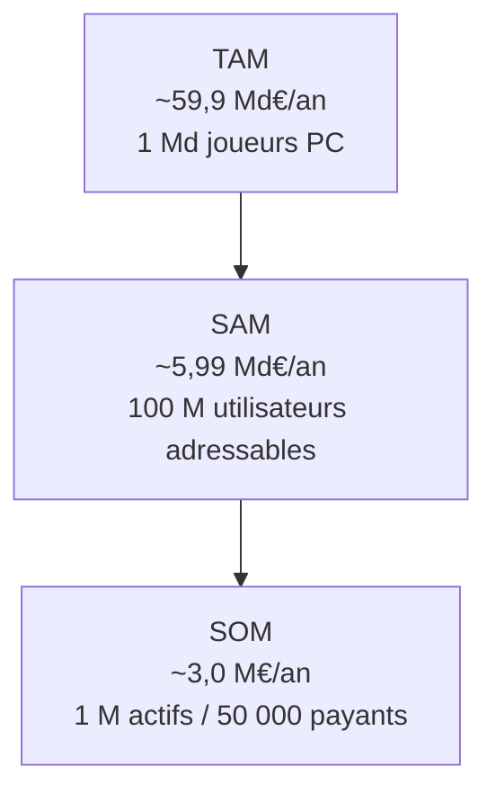
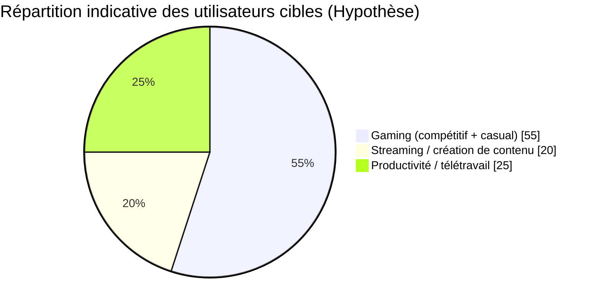
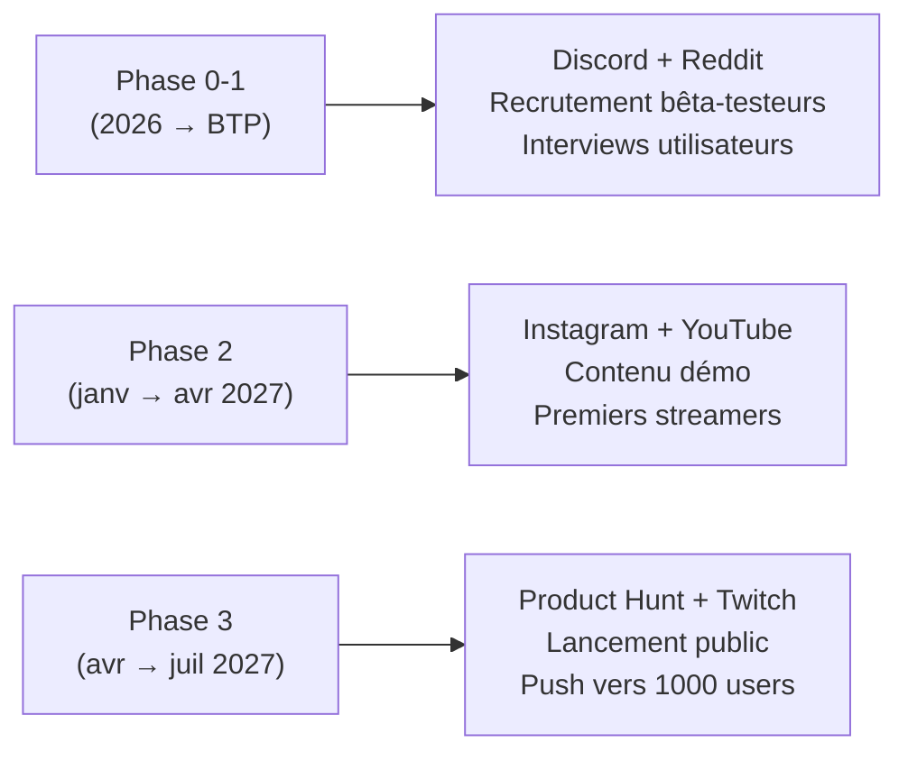
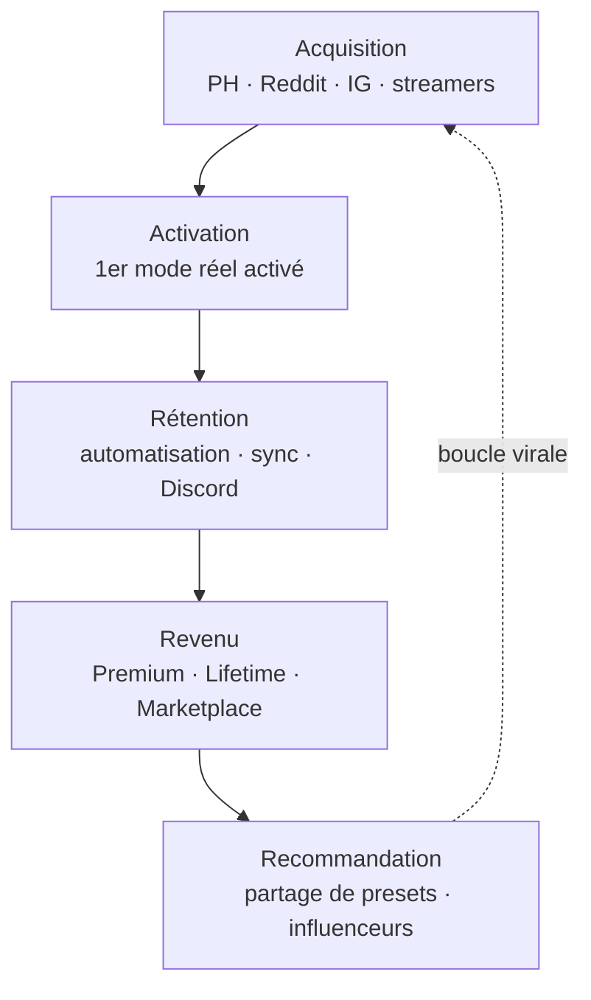
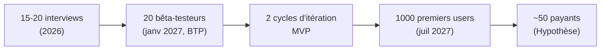

# Nexum — Étude de marché & plan marketing

> Document EIP (piste Entrepreneuriat). Les données chiffrées proviennent du
> `_BRIEF_PROJET.md` (source de vérité), **revérifiées et complétées le 2026-11-05** par
> l'enquête Nexum **[E]** (n = 14) et des sources publiques **[P#]** (voir § 10).
> Ce qui ne peut pas être remplacé par une donnée reste signalé **« Hypothèse »** (c'est le cas
> des cibles, budgets et paramètres de simulation, qui sont des choix et non des mesures).
>
> **Limite principale de l'enquête [E]** : 14 réponses, 11/14 ont 18–24 ans, 10/14 travail/études,
> **1 seul joueur principal, 0 streamer, 0 B2B**. Ce sont des signaux, pas des mesures représentatives.
> Résultats détaillés : `ETUDE_DE_MARCHE_MAJ.md` (annexe).
>
> Dernière mise à jour : 2026-11-05.

---

## 1. Rappel du positionnement produit

Nexum est une **application universelle, no-code et agnostique** qui synchronise en un
clic tout l'environnement numérique (logiciels, système, périphériques, objets
connectés) selon l'activité, via des « modes ».

> Tagline : « Nexum : jouer, streamer ou chiller sans friction. »

Les 5 axes de valeur (radar) : Interopérabilité (5/5), No-code (5/5), Performance
système (4/5), Personnalisation IA (4/5), Stabilité & sécurité (4/5).

---

## 2. Taille et segmentation du marché

### 2.1 Données de cadrage (issues du brief)

| Indicateur | Valeur | Source / statut au 2026-11-05 |
|---|---|---|
| Marché mondial du gaming | **201,6 Md$ (2025, +9,1 %)** *(brief : 197 Md$ = prévision préliminaire)* | Newzoo, 26 juin 2026 **[P1]** ; prévision antérieure 196,7 Md$ **[P2]** |
| Segment PC (gaming) | **43,6 Md$, croissance +12 %** *(brief : 43 Md$, +10,4 %)* | Newzoo **[P1]** ; prévision antérieure **[P2]** |
| Joueurs dans le monde | **3,32 Md** dont **~1 Md sur PC** (franchit le milliard en 2026) | DemandSage (brief) — **non revérifié** |
| Croissance software gaming (TCAC) | **+10,37 % à +12,68 %/an** | Mordor Intelligence (brief) — **non revérifié** |
| Segment abonnement (le plus rapide) | TCAC **~19,5 %** | Mordor Intelligence (brief) — **non revérifié** |
| Smart home / IoT | **147,5 Md$ (2025) → 848,5 Md$ (2034)**, TCAC 21,4 % (2026–2034) | Fortune Business Insights, maj 19 oct. 2026 **[P3]** — **confirmé** |
| Joueurs PC utilisant ≥ 3 marques de périphériques | **> 50 %** | Brief — **non validé** (aucune source publique retrouvée). Proxy **[E]** : 6/14 (43 %) utilisent ≥ 2 catégories de périphériques/objets avec logiciel constructeur ; 2/14 ≥ 3 catégories. |
| Potentiel d'utilisateurs PC | **~1 milliard** | Brief — **non revérifié** |

### 2.2 Calcul TAM / SAM / SOM

Nexum monétise via un **abonnement Premium SaaS à ~4,99 €/mois** (soit **~59,88 €/an**)
et une **licence Lifetime à ~49 €**. Le calcul ci-dessous raisonne en **revenu annuel
potentiel** sur la base du parc d'utilisateurs PC et du prix Premium annuel, ce qui donne
un marché adressable exprimé en valeur.

> **Hypothèses de calcul explicitement posées :**
> - **H1** — Population de base = **1 milliard de joueurs PC** (chiffre du brief, *non revérifié*).
> - **H2** — Prix de référence retenu pour la valorisation = **59,88 €/an** (Premium 4,99 €/mois). Choix conservateur : on ne mélange pas la licence Lifetime.
> - **H3 (SAM)** — Cible réaliste = **joueurs PC multi-périphériques** = **> 50 %** du parc (chiffre du brief, *non validé par source publique*) → on retient **50 %**, soit **500 M** d'utilisateurs pertinents pour une solution agnostique. *Indice d'enquête [E] : 6/14 (43 %) utilisent ≥ 2 catégories de périphériques avec logiciel constructeur — même ordre de grandeur, échantillon non représentatif.*
> - **H4 (SAM)** — Taux d'adressabilité effectif (accès marché, langue, plateforme supportée Windows/Linux, sensibilité au sujet) = **20 %** du segment multi-périphériques. *(Hypothèse.)* *Indices [E] : Windows + Linux = 8/14 (57 %) des répondants, macOS 5/14 (36 %), « plusieurs » 1/14 ; 14/14 citent leurs données personnelles comme frein et 9/14 la fiabilité — la couverture macOS et la confiance pèsent directement sur ce taux.*
> - **H5 (SOM)** — Part de marché captable à un horizon 3-5 ans par un nouvel entrant EIP = **1 %** du SAM en nombre d'utilisateurs *(Hypothèse, aucune donnée ne la valide)*, avec un **taux de conversion payant de 5 %** (freemium). *La conversion est maintenant sourcée : « bon » 3–5 %, moyenne 5,5 % pour un produit freemium (ChartMogul, fév. 2026, 200 entreprises) **[P4]**.*

| Niveau | Définition | Base d'utilisateurs | Base payante | Calcul (valeur annuelle) | Résultat |
|---|---|---|---|---|---|
| **TAM** (Total Addressable Market) | Tous les joueurs PC mondiaux, s'ils payaient le Premium annuel | 1 000 M | 1 000 M | 1 000 M × 59,88 € | **≈ 59,9 Md€/an** |
| **SAM** (Serviceable Available Market) | Joueurs PC multi-périphériques adressables (H3 × H4) | 500 M × 20 % = **100 M** | 100 M | 100 M × 59,88 € | **≈ 5,99 Md€/an** |
| **SOM** (Serviceable Obtainable Market) | Part captable par Nexum à 3-5 ans (H5) | 1 % × 100 M = **1 M** utilisateurs actifs | 5 % × 1 M = **50 000** payants | 50 000 × 59,88 € | **≈ 3,0 M€/an** |

**Sensibilité du SOM au taux de conversion (1 M d'utilisateurs actifs × 59,88 €/an)**

| Conversion | Base payante | Revenu annuel | Référence |
|---|---|---|---|
| 3 % | 30 000 | ≈ 1,8 M€ | bas de la fourchette « bon » **[P4]** |
| **5 %** (hypothèse H5) | 50 000 | **≈ 3,0 M€** | haut de la fourchette « bon » **[P4]** |
| 5,5 % | 55 000 | ≈ 3,3 M€ | moyenne freemium **[P4]** |
| 25 % des produits freemium < 2,5 % | < 25 000 | < 1,5 M€ | **[P4]** — scénario bas |

> ⚠️ Ce calcul suppose un **abonnement** à 59,88 €/an. Dans l'enquête **[E]**, la formule préférée est l'**achat unique (6/14, 43 %)** devant l'abonnement (3/14, 21 %) et le gratuit seul (5/14, 36 %). Si les payants achètent la licence Lifetime à 49 €, le revenu devient **ponctuel** (50 000 × 49 € = ~2,45 M€ une seule fois) et non récurrent. Les prix 4,99 €/mois et 49 € eux-mêmes **ne sont pas validés** (2 réponses seulement sur les seuils de prix, non comparables).

**Lecture pour le jury :** même avec des hypothèses volontairement prudentes (50 % du
segment, 20 % d'adressabilité, 1 % de capture, 5 % de conversion), le SOM à moyen terme
atteint **~3 M€ de revenu annuel récurrent**, sur un TAM de près de **60 Md€**. Le marché
est donc largement assez grand pour justifier le projet, et la contrainte n'est pas la
taille du marché mais l'**exécution** (acquisition + conversion).

> **Note de cohérence :** le TAM « valeur » (59,9 Md€) est du même ordre de grandeur que
> le chiffre d'affaires mondial du gaming (201,6 Md$ en 2025 [P1]) et bien supérieur au seul segment
> software PC — ce qui est logique puisque Nexum adresse aussi la couche IoT/smart home
> (147,5 Md$ en 2025), en forte croissance.

### 2.3 Segmentation

> **Hypothèse** : répartition 55 / 20 / 25 posée pour la planification marketing ; à
> réviser après les 15-20 interviews utilisateurs (Phase 0).

**Ce que dit l'enquête [E] (n = 14, non représentatif)** : usage principal de l'ordinateur — travail/études **10/14**, « un peu de tout » 3/14, jeu **1/14** ; **0 répondant** déclare diffuser ou publier (section streaming vide). Modes préférés (cités) : Travail 12/14, Concentration 8/14, Réunion 7/14, Chill 6/14, Gaming 3/14, Stream 1/14. L'enquête **n'invalide pas** la répartition 55/20/25 (le recrutement a touché des étudiants, pas la communauté gaming), mais elle ne la **confirme pas** : la demande observée est aujourd'hui **orientée travail/productivité**. Il faut recruter des joueurs et des streamers avant de réviser le tableau.

---

## 3. Tendances de marché

| Tendance | Impact pour Nexum | Source / rattachement |
|---|---|---|
| PC gaming en croissance à deux chiffres (**+12 %** en 2025, valeur finale ; brief : +10,4 %) | Marché porteur, base d'utilisateurs qui grandit | Newzoo **[P1]** |
| Le milliard de joueurs PC franchi en 2026 | Fenêtre de lancement favorable (timing EIP) | DemandSage (brief) |
| Modèles par **abonnement** = segment le plus rapide (TCAC ~19,5 %) | Valide le choix du **Premium SaaS** de Nexum | Mordor Intelligence (brief) |
| Explosion du **smart home / IoT** (×5,7 d'ici 2034, TCAC 21,4 %) | Renforce l'axe orchestration IoT (Philips Hue…) — *mais seuls 1/14 utilisent des lumières connectées et 1/14 Home Assistant [E]* | Fortune Business Insights **[P3]** |
| **Fragmentation matérielle** : > 50 % des joueurs ont ≥ 3 marques | Cœur du besoin « agnostique » — différenciateur n°1 ; *« marcher avec toutes les marques » important/indispensable pour 7/14 [E]* | Brief (non validé) |
| Standardisation IoT (**Matter**) | Facilite l'ajout d'intégrations, réduit le coût des connecteurs | SWOT (brief) |
| Boom du **télétravail** (séparation pro/perso) | Ouvre le segment productivité (persona Sarah) | SWOT (brief) |
| Croissance de l'**e-sport** | Alimente le segment gaming compétitif (persona Léo) | SWOT (brief) |
| **Confiance et vie privée** (nouveau, issu de l'enquête) | Frein n°1 : **14/14** citent leurs données personnelles, **9/14** la fiabilité, 6/14 l'accès aux mails/messageries | **[E]** |
| **Messagerie unifiée** (nouveau, issu de l'enquête) | « Voir tous mes messages au même endroit » : **9/14** important/indispensable ; jonglage entre messageries = 1re source d'agacement (3,4/5 ; 8/14 à 4–5) | **[E]** |

---

## 4. Segments cibles & personas

### 4.1 Les trois segments

| Segment | Besoin principal | Déclencheur d'achat | Fonctionnalités clés Nexum |
|---|---|---|---|
| **Gaming** | Performance max, zéro friction avant une session | Perte de temps + reflets/distractions | Couper les process inutiles, régler lumières/RGB, lancer le jeu (Steam/Epic/GOG) |
| **Streaming** | Lancer tout le setup « Direct » en un clic | Complexité OBS + Spotify + lumières + retour caméra | Orchestration multi-logiciels, scènes lumières, un mode « Direct » |
| **Productivité / télétravail** | Séparation nette pro/perso, ambiance adaptée | Même PC pour travail et détente | Automatisation horaire (« Mode Chill » après 18h), couper Slack, tamiser les lumières |

**Couverture par l'enquête [E]** : *Gaming* — 4/14 jouent, 3 ont rempli la section jeu ; friction « préparer mon PC avant de jouer » notée **1,1/5** (0/14 à 4–5). *Streaming* — **0 répondant**, segment non validé. *Productivité* — profil dominant (10/14) ; douleurs : messageries 3,4/5, notifications 2,9/5, réouverture des mêmes applis 2,9/5.

### 4.2 Personas (issus du brief)

| Persona | Profil | Douleur | Ce que Nexum lui apporte |
|---|---|---|---|
| **Léo Bernard, 22 ans** | Gamer compétitif (Valorant, LoL) | Temps de préparation, reflets d'écran | Un mode « Ranked » qui coupe le superflu, règle lumières et volume, lance le jeu |
| **Maxime Roux, 28 ans** | Streamer Twitch | Jongler entre OBS, Spotify, scènes, retour caméra | Un mode « Direct » qui lance tout le setup en un clic |
| **Sarah Martin, 34 ans** | Développeuse en télétravail | Même PC pro/perso, pas de coupure nette | « Mode Chill » automatique après 18h (lumières tamisées, Slack coupé, Spotify lancé) |

> **Validation des personas [E]** : Léo (gamer) — faiblement représenté (1 joueur principal, 3 avec anti-cheat) ; Maxime (streamer) — **non couvert** ; Sarah (télétravail) — proche du profil dominant, mais les répondants sont surtout des étudiants de 18–24 ans (1 seul de 35 ans et plus) et leurs outils du quotidien sont surtout Outlook (8/11), WhatsApp (8/11), Teams (7/11) et Gmail (7/11) ; Slack n'est cité que par 2/11.

---

## 5. Canaux d'acquisition

### 5.1 Cartographie des canaux

| Canal | Segment visé prioritairement | Rôle dans le funnel | Format | Coût |
|---|---|---|---|---|
| **Instagram (showcase)** | Gaming, streaming | Awareness / désir | Reels courts « avant/après », setups RGB, before/after en un clic | Faible (organique) |
| **LinkedIn** | Productivité / télétravail + B2B | Awareness / crédibilité | Posts fondateurs, cas d'usage pro/perso, coulisses EIP | Faible (organique) |
| **Twitch / YouTube** | Gaming, streaming | Awareness / activation | Partenariats streamers, démos live, intégrations sponsorisées | Moyen à élevé |
| **Product Hunt** | Early adopters / tech | Acquisition (pic de lancement) | Lancement « launch day » avec assets, GIF de démo | Faible |
| **Reddit** (r/pcgaming, r/battlestations, r/Twitch…) | Gaming, streaming | Acquisition / communauté | Posts de démo authentiques, AMA, réponses utiles | Faible (organique) |
| **Discord** (serveur Nexum + serveurs partenaires) | Tous | Activation / rétention / rétention communautaire | Support, partage de presets, feedback, bêta | Faible |

**Signaux d'enquête [E] pour les canaux** (réseaux où les répondants suivent leurs créateurs, 13 réponses) :

| Réseau | Répondants | Lecture pour le plan |
|---|---|---|
| Instagram | **11/13** | Confirme la priorité Instagram du plan. |
| YouTube | 6/13 | Cohérent avec la démo vidéo / Shorts. |
| **TikTok** | **6/13** | **Absent du plan actuel** : à ajouter (mêmes formats courts qu'Instagram Reels). |
| LinkedIn | 5/13 | Cohérent avec le segment productivité (et le B2B). |
| X (Twitter) | 2/13 | Marginal. |
| Reddit | 1/13 | Peu suivi dans cet échantillon (biais : peu de gamers). |
| **Twitch** | **1/13** | Peu suivi ; à tester auprès de vrais streamers avant d'y investir. |

Product Hunt et Discord n'étaient pas testés ; l'appétence pour un Discord communautaire est faible (1/14 oui, 4/14 peut-être, 9/14 non), alors que 7/14 veulent tester la bêta.

### 5.2 Priorisation par phase (aligné roadmap EIP)

---

## 6. Funnel AARRR

| Étape | Objectif | Leviers Nexum | KPI indicatif (Hypothèse) |
|---|---|---|---|
| **Acquisition** | Faire venir l'utilisateur | Product Hunt, Reddit, Instagram, streamers | Visiteurs site, installs |
| **Activation** | Premier « aha moment » = 1 mode activé qui agit vraiment | Onboarding, 3 modes gratuits, effet « waouh » Philips Hue | % installs → 1er mode activé ≥ **40 %** |
| **Rétention** | Usage récurrent | Automatisation (Mode Chill), sync cloud multi-machines, Discord | Rétention J30 ≥ **25 %** |
| **Revenu** | Passage au payant | Premium 4,99 €/mois, Lifetime 49 €, Marketplace | Conversion free→payant ≥ **5 %** *(cible ; référence marché 3–5 %, moyenne 5,5 % **[P4]** ; intention déclarée de payer 7/14 **[E]**, un plafond d'intérêt et non un taux réel)* |
| **Recommandation** | Viralité | Partage de presets (Marketplace), effet influenceurs | Coefficient viral k ≥ **0,3** |

> **Hypothèse** : les seuils de KPI ci-dessus sont des **cibles de travail** (activation ≥ 40 %,
> rétention J30 ≥ 25 %, k ≥ 0,3 : aucune donnée d'enquête ni source publique retrouvée), à
> calibrer après les 2 cycles d'itération MVP exigés par l'EIP. Seul le seuil de conversion
> dispose maintenant d'une référence publique **[P4]**.
>
> **Signaux d'enquête utiles à l'activation [E]** : mode de lancement préféré = **un clic dans
> l'application (12/14, dont 10 en 1er choix)** ; l'automatique au lancement d'un jeu n'est
> choisi que par 3/14. Blocages des outils d'automatisation existants (5 répondants ayant
> essayé) : « trop long à configurer » 4/5 → l'onboarding doit être très court.

---

## 7. Plan de contenu

| Pilier de contenu | Canaux | Fréquence (Hypothèse) | Objectif funnel |
|---|---|---|---|
| **« Un clic, tout change »** (démos avant/après) | Instagram, YouTube Shorts, Reddit | 2-3 / semaine | Acquisition / Activation |
| **Effet visuel IoT** (Philips Hue, RGB synchronisés) | Instagram, Twitch | 1 / semaine | Acquisition |
| **Cas d'usage par persona** (Ranked / Direct / Chill) | LinkedIn, YouTube | 1 / semaine | Activation |
| **Coulisses EIP & build in public** | LinkedIn, Discord | 1 / semaine | Crédibilité / communauté |
| **Tutoriels no-code & partage de presets** | YouTube, Discord | 1 / 2 semaines | Rétention / Recommandation |
| **Mises à jour produit / changelog** | Discord, Reddit | À chaque release | Rétention |

> **Note [E]** : aucune donnée ne permet de valider les fréquences de publication. Les messages à
> privilégier d'après l'enquête : **gagner du temps**, **tout remettre comme avant**,
> **confiance / respect des données** (aucune télémétrie non déclarée, aucune revente), plutôt que
> la seule friction « avant de jouer ».

---

## 8. Budget marketing indicatif

> **Hypothèse** : projet étudiant EIP à budget contraint. Le budget ci-dessous est une
> enveloppe **indicative** couvrant la période de lancement (Phase 2 → Phase 3, ~6 mois).
> La stratégie repose d'abord sur l'**organique** (coût quasi nul), les dépenses payantes
> servant uniquement à amplifier autour du lancement Product Hunt et de la démo Greenlight.

| Poste | Détail | Budget indicatif (Hypothèse) |
|---|---|---|
| Partenariats micro-streamers Twitch/YouTube | 3-5 créateurs de niche, contre-partie + petit cachet | 1 500 € |
| Publicité ciblée (Instagram / Reddit) | Amplification autour du lancement | 800 € |
| Assets de lancement (Product Hunt, visuels, montage) | Freelance ponctuel / outils | 500 € |
| Outils (emailing, analytics, design) | Abonnements légers | 400 € |
| Goodies / concours communautaires (Discord) | Fidélisation early adopters | 300 € |
| **Total (~6 mois)** | | **~3 500 €** |

---

## 9. Objectifs de traction

| Jalon | Cible | Échéance (alignée roadmap EIP) |
|---|---|---|
| Interviews utilisateurs (validation marché) | **15-20** interviews | Phase 0 (2026) — *objectif EIP obligatoire*. **État au 05/11/2026 : 14 réponses au questionnaire [E] (12 FR + 2 EN) ; 3/14 acceptent un entretien de 20 min.** Les réponses au formulaire ne remplacent pas des entretiens qualitatifs. |
| **Bêta-testeurs** | **20** bêta-testeurs actifs | Autour du BTP (janvier 2027). *État [E] : 7/14 veulent tester la bêta ; 7/14 donneraient leur avis (6 « de temps en temps », 1 « chaque semaine »).* |
| Cycles d'itération MVP | **2 cycles minimum** | Phase 1 → Phase 2 — *objectif EIP obligatoire* |
| Utilisateurs au lancement public | **Premiers 1000 users** | Phase 3 (avr → juil 2027) |
| Utilisateurs payants (conversion 5 %) | **~50 payants** sur 1000 (**30 à 55** avec la fourchette 3–5,5 % **[P4]**) | Post-Greenlight *(Hypothèse)* |

**Synthèse :** les objectifs de traction sont volontairement calibrés sur le calendrier
EIP (BTP janvier 2027, Greenlight juillet 2027) et sur les exigences obligatoires de la
piste Entrepreneuriat (15-20 interviews, 2 cycles d'itération). Le seuil des « 1000
premiers users » constitue une preuve de traction crédible et démontrable devant le jury,
sans nécessiter un budget d'acquisition significatif grâce à la stratégie majoritairement
organique.

---

## 10. Données d'enquête et sources

**Résumé de ce qui a été remplacé ou confirmé (2026-11-05)**

| Élément du document | Avant | Après |
|---|---|---|
| Marché mondial gaming 2025 | 197 Md$ (prévision) | **201,6 Md$ (+9,1 %)** [P1] |
| Segment PC 2025 | 43 Md$, +10,4 % | **43,6 Md$, +12 %** [P1] |
| Smart home 2025 → 2034 | 147,5 → 848 Md$ | **Confirmé** : 147,52 → 848,47 Md$, TCAC 21,4 % [P3] |
| Conversion freemium | 5 % (hypothèse) | **3–5 % « bon », moyenne 5,5 %** [P4] ; la cible 5 % reste une cible |
| Commission Marketplace / B2B | Hypothèses (30 % ; 3–5 €/poste) | **Benchmarks** : 12–30 % ; 2–7 $/poste/mois [P5–P9] (voir `BUSINESS_MODEL_CANVAS.md`) |
| ~1 Md joueurs PC ; TCAC 10,37–12,68 % ; TCAC abonnement 19,5 % ; > 50 % multi-marques | Brief | **Non revérifiés / non validés** |
| Répartition 55/20/25, H4, H5, KPI AARRR, budget marketing | Hypothèses | **Restent des hypothèses** (choix de planification, non mesurables par l'enquête) |

**Enquête interne**
- **[E]** Formulaires Google « Nexum — Ton avis compte » (FR, 12 réponses) et « Nexum — Help us build it » (EN, 2 réponses), exports CSV fusionnés : 14 réponses (31 oct. → 5 nov. 2026). Les e-mails laissés pour la bêta ne sont pas utilisés.

**Sources publiques**
- **[P1]** Newzoo via Game Developer Reports, 26 juin 2026 — https://gamedevreports.substack.com/p/newzoo-gaming-market-surpassed-200
- **[P2]** Newzoo via GamesBeat (prévision) — https://gamesbeat.com/global-game-revenues-hit-196-7b-in-2025-up-7-4-newzoo/
- **[P3]** Fortune Business Insights, Smart Home Market (maj 19 oct. 2026) — https://www.fortunebusinessinsights.com/smart-home-market-101900
- **[P4]** ChartMogul, The Conversion Report (4 fév. 2026) — https://chartmogul.com/reports/saas-conversion-report/
- **[P5]** PC Gamer, 28 avr. 2021 — https://www.pcgamer.com/most-game-devs-dont-think-steam-earns-its-30-revenue-cut
- **[P6]** Gamepressure, 8 oct. 2019 — https://www.gamepressure.com/newsroom/epic-is-not-just-against-steam-30-is-an-industry-standard/zc1263
- **[P7]** Appbot, 19 oct. 2025 — https://appbot.co/blog/app-developers-apple-google-small-business-programs/
- **[P8]** G2, Senet (maj 8 avr. 2026) — https://www.g2.com/products/senet/pricing
- **[P9]** TrustRadius, Smartlaunch vs ggLeap — https://www.trustradius.com/compare-products/smartlaunch-vs-ggleap
